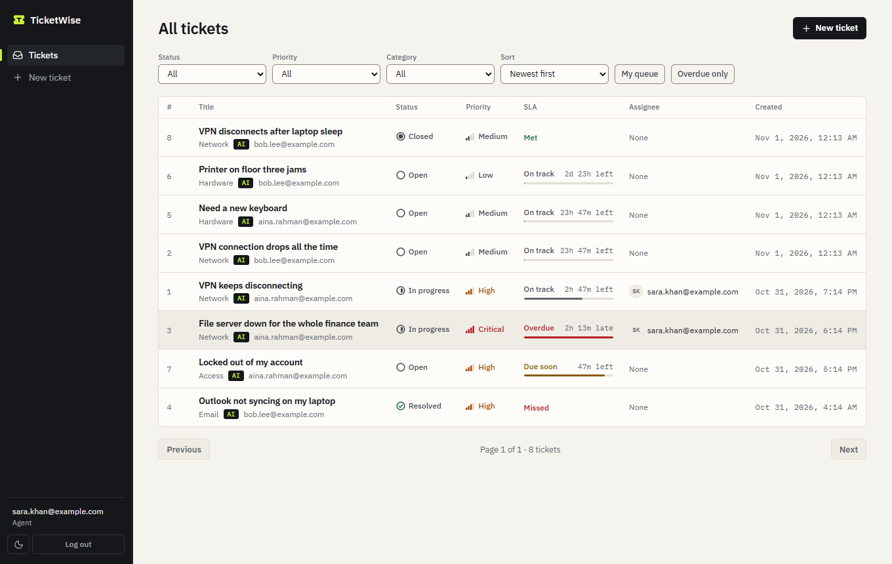
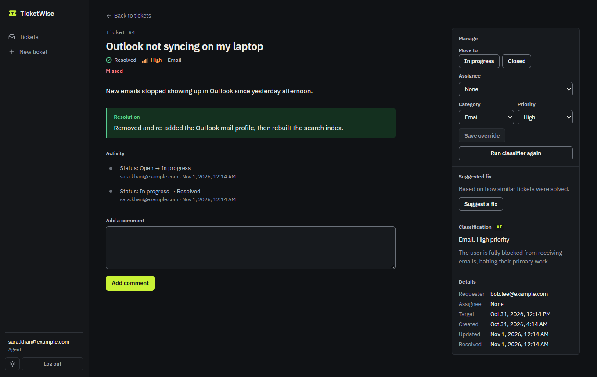
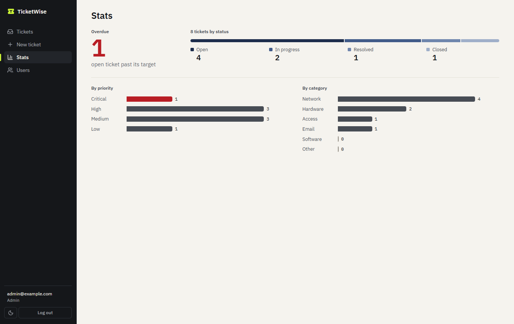
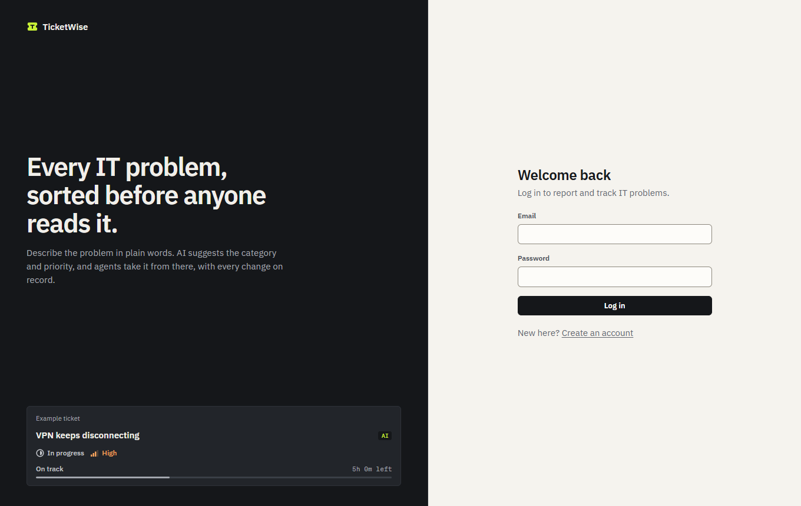
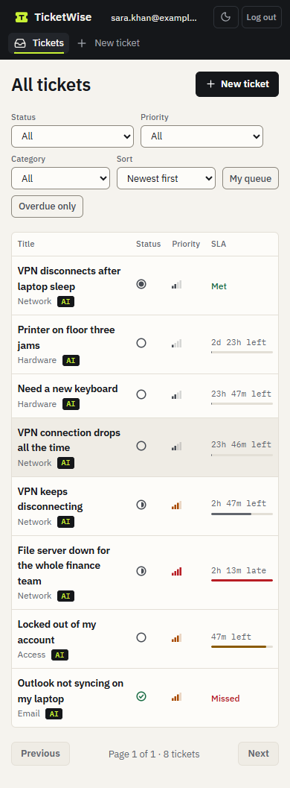
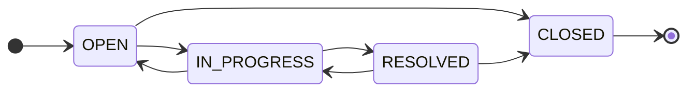
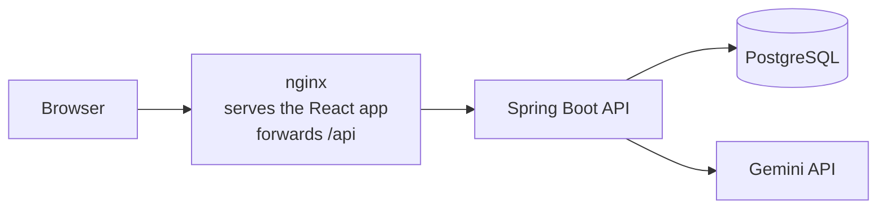
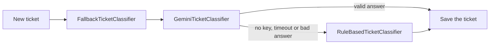
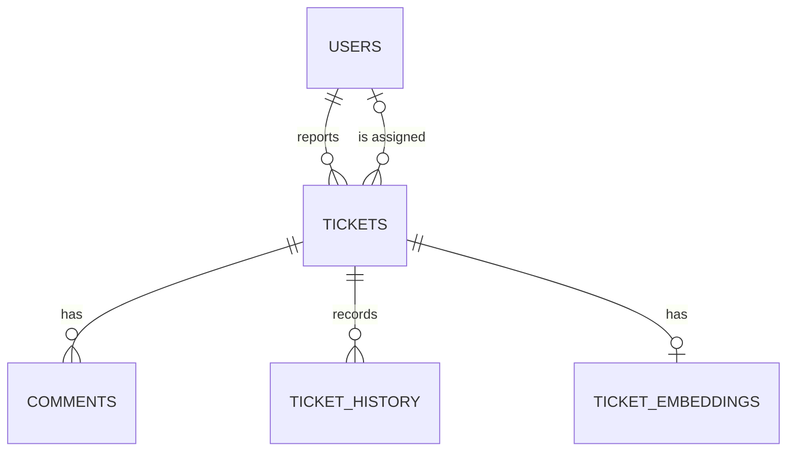

# TicketWise

[](https://github.com/HAIZ4D/ticketwise/actions/workflows/ci.yml)

An AI-assisted IT helpdesk built with Java, Spring Boot and React. Employees report problems in plain words, AI sorts each ticket by category and priority, and IT agents work through a clear queue with service targets and a full audit trail. If the AI is down, tickets are still sorted and saved.

TicketWise is a portfolio project, not a live service. The screenshots use made-up example data.



| Ticket page in the dark theme | Stats for admins |
| --- | --- |
|  |  |

<p>
  
  
</p>

## Contents

- [The problem](#the-problem)
- [How TicketWise solves it](#how-ticketwise-solves-it)
- [Who uses it](#who-uses-it)
- [Features](#features)
- [Tech stack](#tech-stack)
- [Architecture](#architecture)
- [Data model](#data-model)
- [Getting started](#getting-started)
- [Configuration](#configuration)
- [API](#api)
- [Testing](#testing)
- [Security](#security)
- [Known limitations](#known-limitations)
- [Project structure](#project-structure)

## The problem

In many companies, IT support requests arrive by email, chat or phone, as free text. Someone has to read each one and decide what it is and how urgent it is. That causes five problems:

- **Slow triage:** agents spend time reading and sorting before any real work starts.
- **Wrong routing:** a network issue goes to the hardware team, gets passed around, and the person who reported it waits longer.
- **Inconsistent priority:** two agents rate the same issue differently, so a server outage can sit behind a broken mouse.
- **No history:** nobody can see who changed what, or how long problems take to fix.
- **Repeated work:** the same problem gets solved twice, because the first fix is buried in a closed ticket.

## How TicketWise solves it

| Problem | What TicketWise does |
| --- | --- |
| Slow triage | AI suggests a category, a priority and a one-line reason as soon as a ticket is created |
| Wrong routing | Every ticket arrives in one queue with its category, ready to assign to the right agent |
| Inconsistent priority | Each ticket gets a suggested priority, and each priority has a fixed service target |
| No history | Every status, category, priority and assignee change records who did it and when |
| Repeated work | Staff see possible duplicates, and can ask for a fix based on how similar tickets were solved |

Here's what happens to a ticket:

1. An employee writes "VPN keeps disconnecting since this morning".
2. Gemini suggests Network and High, with a short reason. If Gemini can't answer, keyword rules sort the ticket instead.
3. The service target starts from the ticket's priority, and a countdown appears in the queue.
4. An agent accepts or overrides the suggestion, assigns the ticket and moves it through the workflow.
5. The agent checks for duplicates and can ask for a suggested fix.
6. Resolving the ticket needs a note saying how it was fixed. That note can then help with the next similar ticket.

## Who uses it

| Role | What they can do |
| --- | --- |
| Employee | Report problems, follow their own tickets and add comments |
| Agent | See every ticket, assign tickets, change status, override the AI, see duplicates and ask for suggested fixes |
| Admin | Everything an agent can do, plus change user roles and see stats |

Everyone who registers starts as an Employee. Only an admin can change a role, and an admin can't change their own. The first admin comes from the `ADMIN_EMAIL` and `ADMIN_PASSWORD` settings.

## Features

### Ticket handling

- **Tickets:** create, list, view and assign. Agents see every ticket, and employees see only their own.
- **Status workflow:** moves that aren't allowed are rejected by the API.
- **Comments:** anyone with access to a ticket can comment, even after it's closed.
- **Resolution notes:** moving a ticket to Resolved needs a note. Reopening it clears the note and the resolved time.
- **Audit history:** every change records who made it, taken from the login, never from the request.
- **Filters:** by status, priority, category, assignee and overdue tickets, with paging and sorting.



### AI assistance

- **Classification:** Gemini suggests a category, a priority and a one-line reason for each new ticket.
- **Keyword fallback:** if Gemini is down, returns a bad answer or has no API key, keyword rules take over, so a ticket is never lost.
- **Agent override:** an agent can change the category or priority. The AI's suggestion and the final value are both kept, and re-running the classifier never replaces the agent's choice.
- **Duplicate detection:** staff see Open and In Progress tickets that look like the one they're reading, with a similarity score.
- **Suggested fixes:** staff can ask for a suggestion based on how similar tickets were solved, with links to those tickets. If nothing similar has been solved, Gemini isn't called at all.

### SLA tracking

Each priority has a target time, counted from when the ticket was created.

| Priority | Target |
| --- | --- |
| Critical | 4 hours |
| High | 8 hours |
| Medium | 24 hours |
| Low | 72 hours |

An unfinished ticket is On track, Due soon (in the last quarter of its target time) or Overdue. Once it's resolved, it shows Met or Missed. Changing a ticket's priority moves its deadline straight away.

### Dashboard

- **Queue:** status, priority, a live SLA countdown and the assignee for every ticket. Filters are kept in the URL, so they survive a refresh.
- **Ticket page:** comments and changes in one timeline, with management tools in a side panel.
- **Stats:** the overdue count, the split by status, and charts by priority and category.
- **Themes:** light and dark. It follows your system setting until you choose one, then remembers your choice.
- **Phones:** every page fits from 320px wide.
- **Accessibility:** works with a keyboard alone, shows clear focus, respects reduced motion, and text meets WCAG AA contrast in both themes. Status and priority have their own icons, so they don't rely on colour.

## Tech stack

| Area | Technology | Used for |
| --- | --- | --- |
| Language | Java 25 | Backend code |
| Framework | Spring Boot 4.1 | REST API, dependency injection, configuration, scheduled jobs |
| Security | Spring Security 7, JJWT 0.13 | JWT login and role rules |
| Data access | Spring Data JPA, Hibernate | Reading and saving entities, dynamic filters |
| Migrations | Flyway | Versioned database changes (`V1` to `V7`) |
| Database | PostgreSQL 18, H2 | PostgreSQL in Docker, in-memory H2 for quick local runs |
| AI | Google Gemini (`gemini-3.5-flash-lite`, `gemini-embedding-2`) | Classification, suggested fixes and embeddings |
| API docs | Springdoc OpenAPI | Swagger UI |
| Frontend | React 19, TypeScript 7, Vite 8 | The dashboard |
| Frontend data | TanStack Query 5, React Router 8 | Server data, caching and page routing |
| Styling | Plain CSS, IBM Plex, Lucide icons | Light and dark themes, with fonts bundled into the app |
| Backend tests | JUnit, Mockito, Testcontainers 2 | Unit tests and tests on real PostgreSQL |
| Frontend tests | Vitest 5, Testing Library, oxlint | Component tests and linting |
| Delivery | Docker Compose, nginx, GitHub Actions | One-command setup, serving the dashboard, CI |

## Architecture



The browser always talks to one address, so no CORS setup is needed. nginx forwards `/api` in Docker, and Vite does the same in development. The backend is organised by feature, and each feature follows controller, service, repository.

### Classification



This uses the Strategy pattern. All three classes implement `TicketClassifier`, so `TicketService` doesn't know which one ran, and each can be tested alone. All HTTP calls to Gemini stay in `GeminiApi`, so the AI code is in one place.

Gemini is always called before the database transaction starts. A slow network call never holds a database connection open.

### Duplicates and suggested fixes

1. A background job runs every minute and turns new tickets into embeddings, up to 10 at a time. An embedding is a list of numbers that captures what the text means.
2. To compare two tickets, the app calculates the cosine similarity of their embeddings in Java.
3. **Duplicates** are Open or In Progress tickets scoring at least 0.90, up to 3 of them.
4. **Suggested fixes** use tickets with a resolution note scoring at least 0.82. Their notes are sent to Gemini with the new ticket. This is retrieval-augmented generation (RAG), so the suggestion comes from fixes that really worked.
5. Any ticket id in Gemini's reply that the app didn't send is thrown away. If Gemini fails, staff still see the similar tickets.

The limits come from real Gemini scores: unrelated tickets scored up to 0.79, related solved tickets 0.87 to 0.91, and true duplicates 0.92 to 0.97.

### Design decisions

| Decision | Why |
| --- | --- |
| Status rules live only in `TicketStatus`, and each API response includes `nextStatuses` | The dashboard shows only the allowed moves, so the rules are never copied into TypeScript |
| The role is read from the database on every request, not stored in the token | A role change takes effect straight away |
| Another employee's ticket returns the same 404 as a missing ticket | Nobody can find out which ticket ids exist |
| SLA due times are calculated from `createdAt` and the current priority, never stored | A priority change can't leave an old deadline behind |
| The audit log and comments store emails as plain text | The log still reads correctly if an account changes |
| Embeddings are stored as bytes and compared in Java, not with `pgvector` | `pgvector` doesn't run on H2, so this works on both databases |
| Hibernate only validates the schema, and Flyway makes every change | Each database change is versioned and repeatable |

## Data model



| Table | What it holds |
| --- | --- |
| `users` | Email, BCrypt password hash and role |
| `tickets` | Title, description, status, final category and priority, the AI's own suggestion and reason, which classifier ran, whether an agent overrode it, the requester, the assignee, the resolution note and timestamps |
| `comments` | Author email and text |
| `ticket_history` | Which field changed, the old and new values, who changed it and when |
| `ticket_embeddings` | The model name and the embedding as bytes |

## Getting started

### With Docker

This starts the dashboard, the API and PostgreSQL with one command. You only need Docker.

```bash
git clone https://github.com/HAIZ4D/ticketwise.git
cd ticketwise
cp .env.example .env
```

Open `.env` and set `ADMIN_EMAIL` and `ADMIN_PASSWORD` so you get an admin account. Add `GEMINI_API_KEY` to turn on the AI features. Without a key, the app uses keyword rules only. Then start it:

```bash
docker compose up --build
```

| What | Where |
| --- | --- |
| Dashboard | http://localhost:3000 |
| Swagger UI for the API | http://localhost:8080/swagger-ui.html |

Data is kept in a Docker volume, so it survives restarts. `docker compose down` stops the app and keeps your data. `docker compose down -v` deletes the data too.

### Without Docker

**Backend:** you need JDK 25. You don't need to install Maven, because the project includes the Maven Wrapper.

```bash
# Windows
.\mvnw.cmd spring-boot:run

# macOS or Linux
./mvnw spring-boot:run
```

The default `dev` profile uses an in-memory H2 database, so nothing else needs to be installed, but data is lost when the app stops. It reads a `.env` file in the project folder if there is one.

**Frontend:** you need Node 22 or newer. Vite forwards `/api` to the backend on port 8080.

```bash
cd frontend
npm install
npm run dev
```

Then open http://localhost:5173.

### Try it

1. Log in as the admin you set in `.env`.
2. In a private window, register a new account and report a problem, such as "File server down for the whole finance team". The `AI` tag means Gemini sorted the ticket, and `Rules` means the keyword rules did.
3. As the admin, open the **Users** page and make that account an Agent. The change applies on its next page load.
4. Open the ticket, assign it, move it to In progress and change its priority. Each step appears in the timeline.
5. Resolve the ticket with a note, then open **Stats**.

## Configuration

Settings come from environment variables or a local `.env` file. Copy `.env.example` to `.env` and fill in your own values. Never commit `.env`.

| Variable | Default | What it does |
| --- | --- | --- |
| `ADMIN_EMAIL`, `ADMIN_PASSWORD` | None | Create the first admin at startup, if that account doesn't exist yet |
| `GEMINI_API_KEY` | None | Turns on Gemini. Without it, the app uses keyword rules only, and duplicates and suggested fixes are unavailable |
| `GEMINI_MODEL` | `gemini-3.5-flash-lite` | The model for classification and suggestions |
| `GEMINI_EMBEDDING_MODEL` | `gemini-embedding-2` | The model for embeddings |
| `GEMINI_TIMEOUT_MS` | `5000` | How long to wait for Gemini |
| `GEMINI_BASE_URL` | Google's API | Points the app at a test server instead |
| `JWT_SECRET` | Random at startup | Signs login tokens. Use at least 32 random characters, or everyone has to log in again after a restart |
| `JWT_EXPIRATION_MINUTES` | `60` | How long a login lasts |
| `DB_URL`, `DB_USERNAME`, `DB_PASSWORD` | Set by Docker Compose | The database for the `prod` profile. Compose has a local-only default password |

A Gemini key must have no website restriction, because the calls come from a server, not a browser.

SLA targets and similarity limits are in [`src/main/resources/application.yml`](src/main/resources/application.yml).

## API

All paths start with `/api/v1`. Everything except `/auth` needs an `Authorization: Bearer <token>` header. In Swagger UI, use the **Authorize** button.

| Method | Path | What it does | Who |
| --- | --- | --- | --- |
| POST | `/auth/register` | Create an account and get a token | Anyone |
| POST | `/auth/login` | Get a token | Anyone |
| POST | `/tickets` | Create a ticket and classify it | Everyone |
| GET | `/tickets` | List tickets. Filters: `status`, `priority`, `category`, `assigneeId`, `overdue`. Also `page`, `size`, `sort` | Employees get their own |
| GET | `/tickets/{id}` | Get one ticket | Employees get their own |
| GET | `/tickets/{id}/comments` | List comments | Employees get their own |
| POST | `/tickets/{id}/comments` | Add a comment | Employees on their own |
| GET | `/tickets/{id}/history` | Read the audit log | Employees get their own |
| PATCH | `/tickets/{id}/status` | Change status. Resolving needs a `resolution` note | Agent, Admin |
| PATCH | `/tickets/{id}/classification` | Override category, priority or both | Agent, Admin |
| PATCH | `/tickets/{id}/assignee` | Assign to an agent, or send `null` to unassign | Agent, Admin |
| POST | `/tickets/{id}/reclassify` | Run the classifier again | Agent, Admin |
| GET | `/tickets/{id}/duplicates` | Open tickets that look similar | Agent, Admin |
| POST | `/tickets/{id}/suggestion` | Suggest a fix from similar solved tickets | Agent, Admin |
| GET | `/users/me` | Get your own account | Everyone |
| GET | `/users/agents` | List agents and admins | Agent, Admin |
| GET | `/users` | List users | Admin |
| PATCH | `/users/{id}/role` | Change a user's role | Admin |
| GET | `/stats` | Counts by status, category and priority, plus the overdue count | Admin |

### Example

Register, then create a ticket:

```bash
curl -X POST http://localhost:8080/api/v1/auth/register \
  -H "Content-Type: application/json" \
  -d '{"email":"aina@example.com","password":"choose-a-password"}'

curl -X POST http://localhost:8080/api/v1/tickets \
  -H "Content-Type: application/json" \
  -H "Authorization: Bearer <token from the response above>" \
  -d '{"title":"VPN keeps disconnecting","description":"My VPN drops every 10 minutes."}'
```

The response looks like this, shortened here:

```json
{
  "id": 1,
  "title": "VPN keeps disconnecting",
  "status": "OPEN",
  "nextStatuses": ["IN_PROGRESS", "CLOSED"],
  "category": "NETWORK",
  "priority": "HIGH",
  "aiCategory": "NETWORK",
  "aiPriority": "HIGH",
  "aiReason": "Repeated VPN drops are blocking the user's work.",
  "classifiedBy": "GEMINI",
  "overridden": false,
  "slaState": "ON_TRACK",
  "slaDueAt": "2026-11-01T16:00:00Z"
}
```

### Errors

Every error has the same shape. Validation errors also include a `fieldErrors` list.

```json
{
  "status": 404,
  "error": "Not Found",
  "message": "Ticket 99 not found",
  "path": "/api/v1/tickets/99",
  "timestamp": "2026-11-01T08:00:00Z"
}
```

| Code | Meaning |
| --- | --- |
| 400 | The input is invalid, or the sort field doesn't exist |
| 401 | You aren't logged in, or the email or password is wrong |
| 403 | Your role can't do this |
| 404 | The ticket doesn't exist, or it isn't yours |
| 409 | The status move isn't allowed, or the email is already registered |
| 503 | Suggestions are unavailable right now |

## Testing

| Suite | Tests | Runs on |
| --- | --- | --- |
| Backend fast tests | 237 | No Docker needed |
| Backend integration tests | 22 | Real PostgreSQL through Testcontainers |
| Frontend tests | 118 | Vitest and Testing Library |

```bash
# Fast backend tests, no Docker needed
./mvnw test

# All backend tests, including real PostgreSQL. Docker must be running.
./mvnw verify

# Frontend tests, lint, type checks and build
cd frontend
npm test
npm run lint
npm run typecheck
npm run build
```

On Windows, use `.\mvnw.cmd` instead of `./mvnw`. Tests never call the real Gemini API.

Every push and pull request to `main` runs the backend tests, the frontend lint, tests and build, and builds both Docker images with GitHub Actions.

## Security

- Passwords are stored only as BCrypt hashes.
- Login uses signed JWTs with no server session. The role is read from the database on every request, so a role change takes effect immediately.
- Role rules for each URL are in one place, `SecurityConfig`. The dashboard hides staff controls from employees, but the API enforces every rule.
- Requests never say who is acting. "Who did this" always comes from the logged-in user.
- An employee asking for someone else's ticket gets the same 404 as for a ticket that doesn't exist.
- Secrets come from environment variables, never from the code.
- The dashboard is served with a Content Security Policy, loads nothing from other sites, and always shows ticket text as plain text.
- Both app containers run as a non-root user, and Docker publishes their ports on `localhost` only.

**What goes to Google:** the title and description of tickets, for classification and embeddings, plus the resolution notes of similar solved tickets for suggestions. Emails are never sent, and neither are the titles or descriptions of those past tickets. Gemini is told to ignore any instructions inside ticket text, and its answers must match a fixed format.

The dashboard keeps its token in `localStorage`, so it survives a refresh. An `httpOnly` cookie would be safer against script attacks, but would need CSRF protection.

## Known limitations

These are still missing before any real deployment:

- **Login limits:** nothing limits repeated login attempts.
- **Sessions:** there are no refresh tokens. Logging out removes the token from the browser, but the token stays valid until it expires, 60 minutes by default.
- **Email verification:** anyone can register with any address.
- **Scale:** similarity search compares embeddings one by one in Java. That suits a helpdesk with thousands of tickets, but a dedicated vector database would be needed for millions.

Email notifications and file attachments aren't built. The dashboard has been tested in Chrome, but not in Safari or Firefox. In Windows high contrast mode the SLA and chart bars disappear, but every number stays as text.

## Project structure

```text
ticketwise/
├── src/main/java/com/haizad/ticketwise/
│   ├── ticket/            Tickets, status rules, SLA policy and stats
│   ├── classification/    Gemini and keyword classifiers, and all Gemini HTTP calls
│   ├── similarity/        Embeddings, duplicate search and suggested fixes
│   ├── comment/           Ticket comments
│   ├── history/           The audit log
│   ├── user/              Users and roles
│   ├── security/          JWT login, role rules and the first admin
│   └── common/            Error handling and shared configuration
├── src/main/resources/
│   ├── application.yml    Settings, including SLA targets and similarity limits
│   └── db/migration/      Flyway SQL migrations, V1 to V7
├── src/test/              Backend tests. Files ending in IT run on real PostgreSQL
├── frontend/
│   ├── src/api/           API calls and shared types
│   ├── src/auth/          Login state
│   ├── src/components/    Sidebar, badges, SLA meter, icons and theme switch
│   ├── src/pages/         One file per screen, with ticket panels in pages/ticket/
│   ├── src/styles.css     The design: colour tokens, themes and all components
│   ├── nginx.conf         Serves the app and forwards /api
│   └── Dockerfile
├── docs/screenshots/
├── .github/workflows/     CI
├── docker-compose.yml     Dashboard, API and PostgreSQL
├── Dockerfile             The API image
└── .env.example           Every setting, with empty secrets
```

## Author

Built by [HAIZ4D](https://github.com/HAIZ4D).
